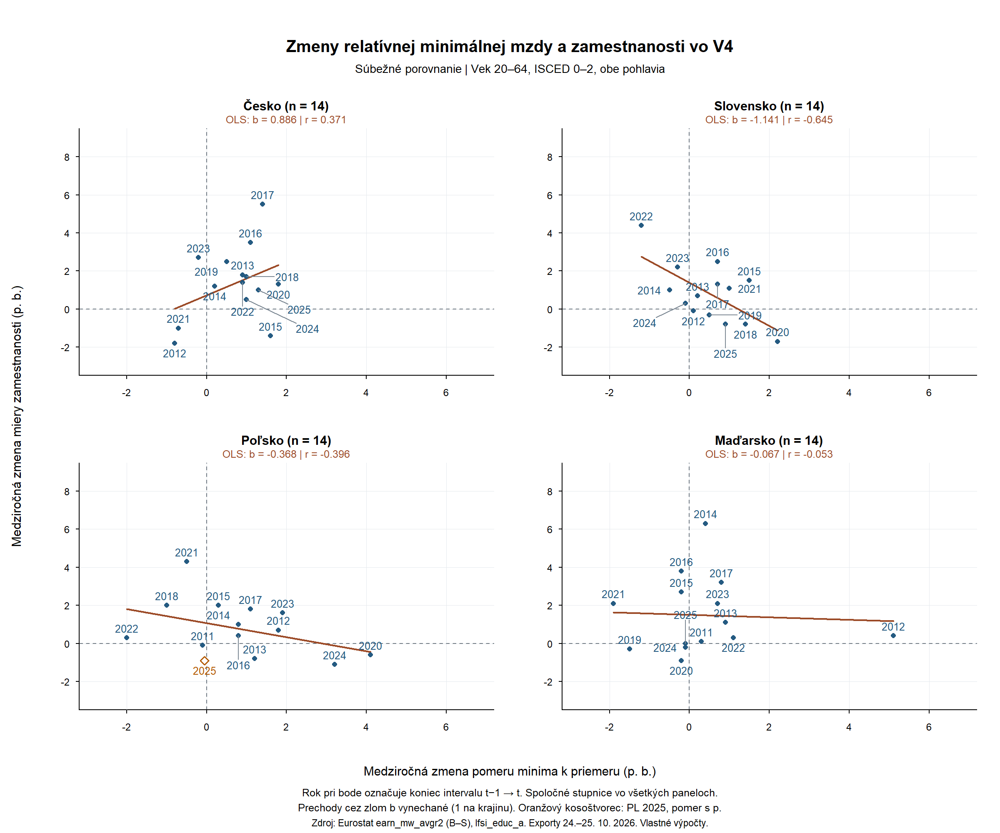

# Relatívna minimálna mzda a zamestnanosť vo V4

Portfóliový analytický projekt v R. Skúma súvislosť medzi medziročnými zmenami pomeru minimálnej mzdy k priemernej mzde a medziročnými zmenami miery zamestnanosti ľudí s nízkym vzdelaním. Každú krajinu V4 posudzuje osobitne v období **2010–2025**.

**[Čítať finálny report →](reports/REPORT.md)** · [R skripty](R/) · [Výsledkové tabuľky a grafy](outputs/)

Analytická a reportová etapa boli uzavreté 17. 11. 2026. Výsledky opisujú asociácie; neurčujú kauzálny účinok minimálnej mzdy ani odporúčanú výšku jej nastavenia.

## Otázka a hlavné zistenia

Ako v jednotlivých krajinách V4 v období 2010–2025 súvisia medziročné zmeny relatívnej minimálnej mzdy s medziročnými zmenami miery zamestnanosti osôb s nízkym vzdelaním vo veku 20–64 rokov?

- Na **Slovensku a v Poľsku** sa pri súbežnom porovnaní väčšie zmeny pomeru spájali s nižšími zmenami zamestnanosti. Nižšia zmena môže znamenať menší rast aj väčší pokles zamestnanosti.
- V **Česku** mala súbežná asociácia kladný smer; v **Maďarsku** bola blízka nule.
- Pri **jednoročnom oneskorení** sa záporná asociácia Slovenska a Poľska neopakovala. Rozdiel časovaní zostal aj pri porovnaní na spoločných prípustných rokoch vnútri každej krajiny.
- Slovenský súbežný výsledok zostal záporný aj pri použití **mediánu namiesto priemeru**. Ide o posúdenie citlivosti na menovateľ, nie nezávislé potvrdenie správnosti analýzy.



*Jeden bod predstavuje ročný pár zmien. Obe osi sú v percentuálnych bodoch. Priamky sú opisné OLS odhady s konštantou; úplné vysvetlenie výberu rokov, výsledkov a obmedzení je v reporte.*

## Dáta a postup

Zdrojom sú uložené exporty Eurostatu z 24.–25. 10. 2026:

| Ukazovateľ | Dataset | Vymedzenie |
|---|---|---|
| Miera zamestnanosti | [lfsi_educ_a](https://ec.europa.eu/eurostat/databrowser/view/lfsi_educ_a/default/table?lang=en) | Vek 20–64, ISCED 0–2, obe pohlavia; % populácie skupiny |
| Miera nezamestnanosti – doplnok | [une_educ_a](https://ec.europa.eu/eurostat/databrowser/view/une_educ_a/default/table?lang=en) | Rovnaká skupina; % ekonomicky aktívnych |
| Relatívna minimálna mzda | [earn_mw_avgr2](https://ec.europa.eu/eurostat/databrowser/view/earn_mw_avgr2/default/table?lang=en) | Pomer hrubého minima k priemernej hrubej mzde, NACE Rev. 2 B–S; slovenský medián ako doplnok |

Analytická tabuľka má **64 riadkov krajina × rok**. Rozdiely a oneskorené páry vznikajú na úplnom kalendárnom rade pred výlukami. Porovnania prechádzajúce cez zostávajúce časové zlomy sa nepoužijú; pôvodné údaje a značky zostávajú zachované.

Analýza využíva grafy, jednoduchú lineárnu regresiu s konštantou a Pearsonovu koreláciu. Citlivosť skúma postupným vynechaním každého jednotlivého ročného páru a porovnaním časovaní na spoločných rokoch. Obsahuje 9 základných regresných odhadov a 124 odhadov po vynechaní pozorovania. Nezamestnanosť zostáva grafickým doplnkom bez regresie.

Krátke rady, meniace sa zloženie vzdelanostnej skupiny, národné metodické odchýlky a ďalšie ekonomické vplyvy obmedzujú interpretáciu. Pomer sa môže meniť aj vývojom priemernej mzdy; jeho zmena preto neizoluje zásah zákonodarcu. Podrobnosti a zdroje sú v [metodike reportu](reports/REPORT.md#3-dáta-a-metodika).

## Spustenie

Otvorte `minimum-wage-v4.Rproj` v RStudio a pracujte z koreňa projektu. Potrebujete R a balíček **readxl**; zvyšok používa základné funkcie R. Autor skripty spúšťal v R 4.6.1. Presná verzia readxl ani súbor so zamknutými verziami závislostí nie sú zaznamenané.

V novej R relácii spustite v uvedenom poradí:

```r
source("R/01_import_eurostat.R", encoding = "UTF-8")
source("R/02_priprava_dat.R", encoding = "UTF-8")
source("R/04_analyticka_tabulka.R", encoding = "UTF-8")
source("R/05_casove_grafy.R", encoding = "UTF-8")
source("R/08_opisna_regresia.R", encoding = "UTF-8")
uloz_grafy_reportu()
source("R/09_spolocne_roky.R", encoding = "UTF-8")
```

Skript 02 automaticky spúšťa kontroly zo skriptu 03. Skript 08 načíta grafické funkcie zo skriptov 06 a 07 vrátane spoločnej pomôcky na popisky; netreba ich spúšťať samostatne. Skript 05 vytvára aj spoločný časový graf, ktorý nie je súčasťou finálneho reportu.

Opakované spustenie obnovuje príslušné spracované CSV a PNG, **nemení pôvodné XLSX**. Kontroly zastavia beh pri nesplnení očakávanej štruktúry alebo vybraných referenčných hodnôt. Sú nastavené na priložené exporty; pri novom stiahnutí dát treba znovu posúdiť revízie, rozloženie listov a značky. Úspešný beh sám neoveruje metodickú porovnateľnosť.

## Orientácia v projekte

| Cesta | Obsah |
|---|---|
| [reports/REPORT.md](reports/REPORT.md) | Finálny report s metodikou, výsledkami, zdrojmi a prílohami |
| [R/](R/) | Import, príprava, kontroly, grafy a opisná analýza |
| [data/raw/](data/raw/) | Pôvodné exporty Eurostatu vrátane značiek |
| [data/processed/](data/processed/) | Spracované tabuľky a analytický vstup |
| [outputs/](outputs/) | Grafy a výsledkové aj diagnostické CSV |
| [DECISION_LOG.md](DECISION_LOG.md) | Prijaté rozhodnutia, alternatívy a dôvody |
| [PROJECT_BRIEF.md](PROJECT_BRIEF.md) | Projektový kontext a metodické zdôvodnenia |
| [CURRENT_STATE.md](CURRENT_STATE.md) | Priebeh práce, vykonané kontroly a aktuálny stav |
| [learning/](learning/) | Priebežné poznámky a cvičenia v R |

Aktuálna analýza používa vek **20–64 rokov**. Súbory s označením `25_64` a pôvodné exporty `lfsa_*` zachovávajú staršiu etapu, do aktuálnych výpočtov nevstupujú. `reports/PRACOVNE_VYSLEDKY.md` je historický podklad; konečný výklad je v `reports/REPORT.md`.

## Spolupráca a dohľadateľnosť

Projekt vznikol partnerskou analytickou spoluprácou autora s AI. Autor určil tému, prijímal konečné rozhodnutia, získal exporty, spúšťal R skripty a vizuálne kontroloval vybrané hodnoty. AI prispievala metodickými návrhmi, vyhľadávaním zdrojov, tvorbou a úpravami kódu, kontrolami a návrhmi textu. Rozsah kontrol a podiel oboch strán sú zaznamenané v projektových dokumentoch a reporte.

Rozhodnutia a pracovné etapy boli dokumentované počas projektu. Pri neskoršom založení Git repozitára sa táto predchádzajúca práca nevydáva za spätne vytvorenú históriu commitov.

## Zdroj dát a opätovné použitie

Zdroj: **Eurostat**. Priložené exporty zachovávajú stav pri získaní dát; živé tabuľky sa môžu následne revidovať. Spracované tabuľky a grafy sú vlastným spracovaním týchto údajov. Pri použití dát treba uviesť zdroj a rešpektovať [podmienky opätovného použitia Eurostatu](https://ec.europa.eu/eurostat/help/copyright-notice). Toto uvedenie zdroja neudeľuje samostatnú licenciu ku kódu a textom projektu.
