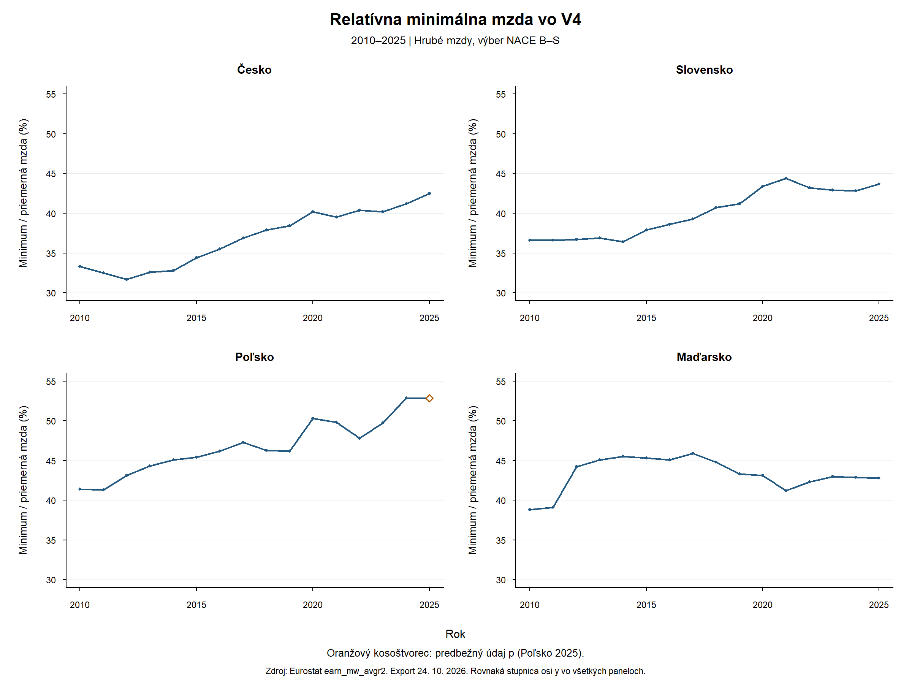
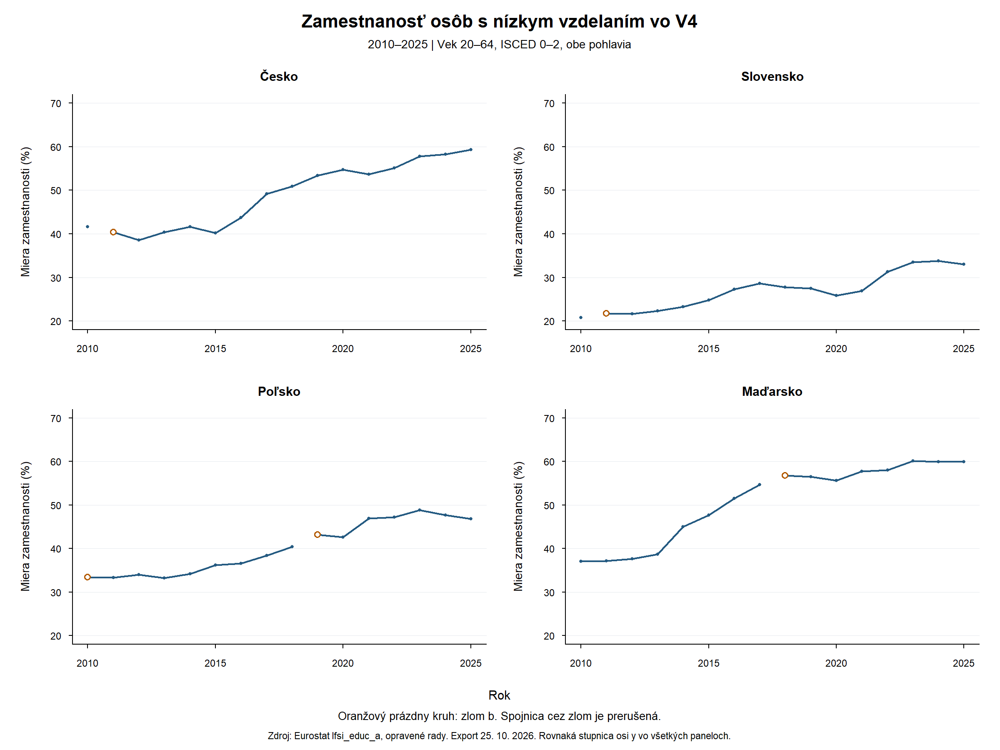
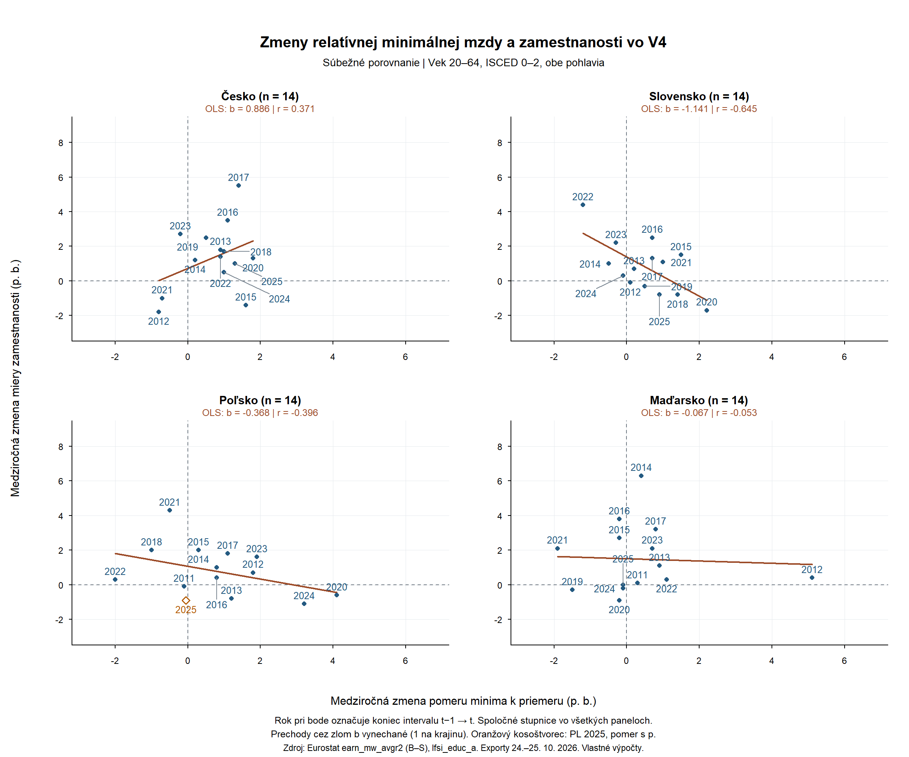
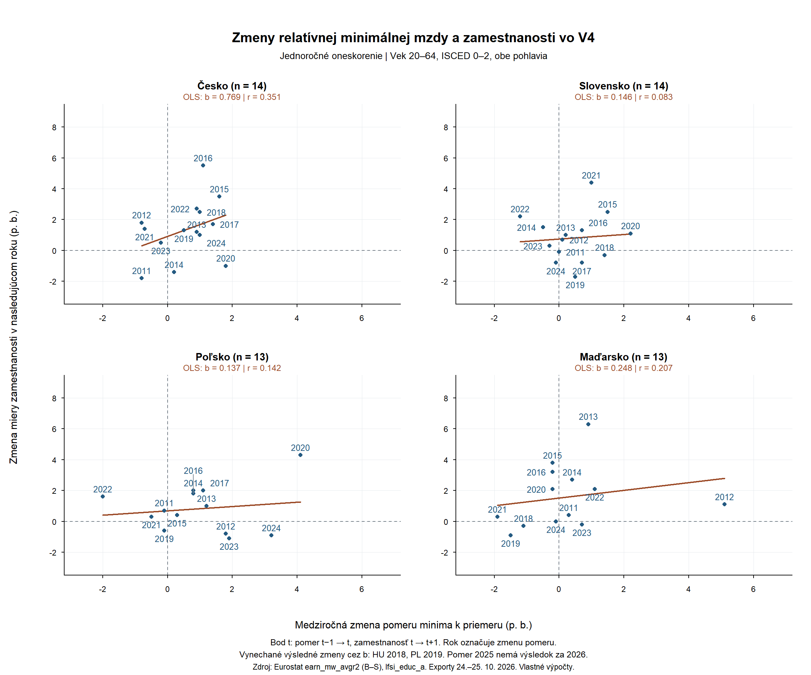
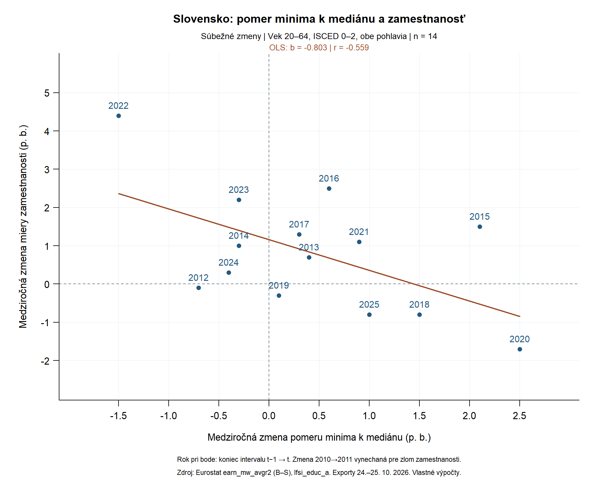
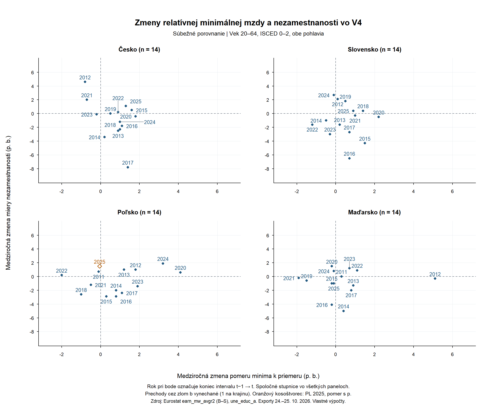
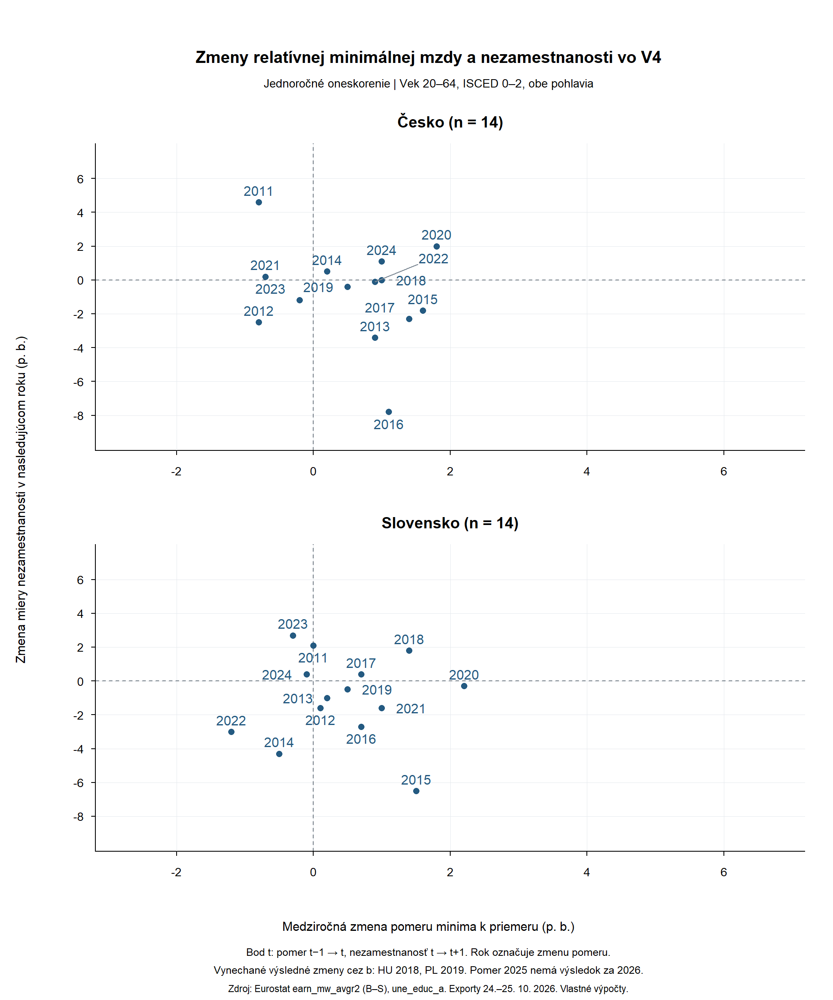
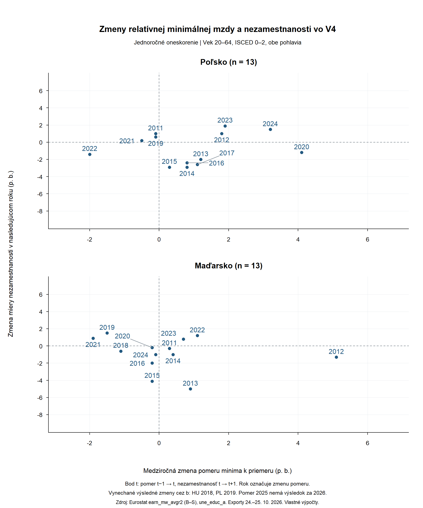

# Relatívna minimálna mzda a zamestnanosť ľudí s nízkym vzdelaním vo V4

Obdobie 2010–2025

**Finálna verzia schválená autorom – 17. 11. 2026.**

## Zhrnutie hlavných zistení

Projekt skúma, ako v jednotlivých krajinách V4 v období 2010–2025 súviseli medziročné zmeny relatívnej minimálnej mzdy so zmenami miery zamestnanosti osôb vo veku 20–64 rokov s nízkym vzdelaním (ISCED 0–2). Relatívnu silu minima vyjadruje jeho pomer k priemernej hrubej mzde. Analýza využíva ročné údaje Eurostatu a každú krajinu posudzuje osobitne pomocou grafov, jednoduchej opisnej regresie a korelácie. Po výlukách cez zostávajúce časové zlomy obsahujú základné odhady 13 alebo 14 ročných párov.

Pri súbežnom porovnaní sa väčšie zmeny pomeru spájali s nižšími zmenami zamestnanosti na Slovensku a v Poľsku. Nižšia zmena môže znamenať menší rast aj väčší pokles zamestnanosti. V Česku mala asociácia kladný smer a v Maďarsku bola blízka nule. Výsledky preto neposkytujú jednotnú smerovú oporu východiskovému očakávaniu negatívnej súvislosti vo všetkých krajinách V4.

Záporný súbežný sklon Slovenska a Poľska pretrvával po vynechaní ktoréhokoľvek jednotlivého ročného pozorovania. Na Slovensku zostal záporný aj pri použití mediánu namiesto priemeru. Pri jednoročnom oneskorení sa však záporná asociácia týchto dvoch krajín neopakovala a odhady boli blízke nule. Rozdiel časovaní pretrvával aj po porovnaní na rovnakých prípustných rokoch zmeny pomeru vnútri krajiny.

Zistenia opisujú súvislosti, nie kauzálny účinok minimálnej mzdy. Pomer sa mení aj vývojom priemernej mzdy a zamestnanosť aj mzdové veličiny môžu reagovať na spoločné ekonomické príčiny. Krátke rady, meniace sa zloženie skúmanej skupiny a národné metodické odchýlky obmedzujú zovšeobecnenie. Samotná analýza preto neurčuje, či konkrétne zvýšenie zákonnej sadzby spôsobilo zmenu zamestnanosti, ani aká výška minima by bola vhodná.

## 1. Motivácia a cieľ

Pri nastavovaní minimálnej mzdy vzniká otázka, ako sa ochrana príjmov pracovníkov spája s ich možnosťami zamestnať sa. Východiskom projektu je záujem o pracovné uplatnenie ľudí s nízkym vzdelaním a o to, či jeho vývoj súvisí so zmenami relatívnej výšky zákonnej mzdovej hranice. Výsledok má byť užitočný pre čitateľov so záujmom o sociálnu a pracovnú politiku vrátane ľudí pripravujúcich podklady pre legislatívne rozhodovanie.

Analýza sleduje Česko, Slovensko, Poľsko a Maďarsko v období 2010–2025. Každú krajinu posudzuje osobitne a následne porovnáva zistené súvislosti. Zámerom je opísať, či sa väčšie medziročné zmeny relatívnej minimálnej mzdy spájajú s vyššími alebo nižšími medziročnými zmenami zamestnanosti skúmanej skupiny. Dostupné údaje a zvolený postup umožňujú skúmať asociácie; neoddeľujú samotný účinok zákonnej minimálnej mzdy od ostatných ekonomických vplyvov.

## 2. Výskumná otázka a východisková hypotéza

**Výskumná otázka:** Ako v jednotlivých krajinách V4 v období 2010–2025 súvisia medziročné zmeny relatívnej minimálnej mzdy s medziročnými zmenami miery zamestnanosti osôb s nízkym vzdelaním vo veku 20–64 rokov?

Relatívnu minimálnu mzdu v hlavnej analýze vyjadrujeme pomerom hrubej minimálnej mzdy k priemernej hrubej mesačnej mzde vo vybranom odvetvovom pokrytí B–S. Pomer minima k priemernej alebo mediánovej mzde patrí medzi zavedené relatívne mzdové ukazovatele. Jeho vývoj závisí od minima aj referenčných zárobkov. [ILO: Ratio of minimum to average wages](https://www.ilo.org/resource/55-ratio-minimum-average-wages).

Skúmanú skupinu tvoria osoby s dosiahnutým vzdelaním ISCED 0–2 vo veku 20–64 rokov, obe pohlavia. Označenie „nízke vzdelanie“ vymedzuje skupinu podľa vzdelania; samo osebe neurčuje mzdu, produktivitu ani konkrétne pracovné zručnosti jednotlivcov.

**Východisková hypotéza:** Medzi medziročnými zmenami relatívnej minimálnej mzdy a medziročnými zmenami miery zamestnanosti skúmanej skupiny očakávame negatívnu súvislosť.

### Teoretické východisko a hranice očakávania

Očakávanie vychádza z konkurenčného modelu trhu práce: záväzná minimálna mzda nad úrovňou, ktorá by vznikla bez nej, môže zvýšiť náklady dotknutých pracovných miest a obmedziť dopyt po práci. Reakciou môže byť menšie prijímanie pracovníkov, znižovanie zamestnanosti alebo nahrádzanie práce technológiami. Ide však o podmienený mechanizmus. Modely, v ktorých majú zamestnávatelia moc držať mzdy pod príspevkom pracovníkov k produkcii, pripúšťajú pri určitom nastavení minima aj rast zamestnanosti. Vyššie mzdy môžu zároveň podporovať spotrebný dopyt. [ILO: Employment effects in different economic theories](https://www.ilo.org/resource/employment-effects-different-economic-theories).

Teoretický mechanizmus preto motivuje očakávaný smer, ale nezaručuje ho pri našej metrike ani skúmanej skupine. Pomer môže rásť aj pri poklese priemernej mzdy a osoby s nízkym vzdelaním nie sú totožné s príjemcami minimálnej mzdy. Projekt má exploračný charakter s východiskovou hypotézou: pripúšťa odlišné výsledky medzi krajinami aj medzi súbežným a jednoročne oneskoreným porovnaním.

## 3. Dáta a metodika

### 3.1. Zdroje a skúmaná skupina

Používame ročné údaje Eurostatu za Česko, Slovensko, Poľsko a Maďarsko v období 2010–2025. Analýza vychádza z pôvodných exportov získaných 24.–25. 10. 2026; neskoršie revízie sa do tejto verzie automaticky nepremietajú.

| Ukazovateľ | Dataset Eurostatu | Výber a jednotka |
|---|---|---|
| Relatívna minimálna mzda | [earn_mw_avgr2](https://ec.europa.eu/eurostat/databrowser/view/earn_mw_avgr2/default/table?lang=en) | Minimum ako % priemernej hrubej mesačnej mzdy, NACE Rev. 2 B–S |
| Miera zamestnanosti | [lfsi_educ_a](https://ec.europa.eu/eurostat/databrowser/view/lfsi_educ_a/default/table?lang=en) | Vek 20–64, ISCED 0–2, obe pohlavia, % príslušnej populácie (PC_POP) |
| Miera nezamestnanosti | [une_educ_a](https://ec.europa.eu/eurostat/databrowser/view/une_educ_a/default/table?lang=en) | Rovnaká skupina, % ekonomicky aktívnych (PC_ACT) |
| Slovenský mediánový doplnok | earn_mw_avgr2 | Minimum ako % mediánovej hrubej mesačnej mzdy, B–S |

Základná analytická tabuľka má 64 riadkov: jeden riadok predstavuje jednu krajinu v jednom roku. Obsahuje hodnoty ukazovateľov, zdrojové značky, vypočítané zmeny a príznaky použiteľnosti jednotlivých porovnaní.

Pri ukazovateľoch trhu práce volíme oficiálne rady zahŕňajúce korekcie časových zlomov, aby sme zlepšili kontinuitu porovnávania. Korekcie však neodstraňujú všetky zostávajúce zlomy ani nezaručujú úplnú porovnateľnosť. [Eurostat: LFS main indicators](https://ec.europa.eu/eurostat/cache/metadata/en/lfsi_esms.htm).

Vek 20–64 umožňuje využiť tieto rady a oproti pôvodne zvažovanému veku 25–64 zachovať viac použiteľných porovnaní. Zahrnuté osoby vo veku 20–24 rokov môžu ešte študovať alebo meniť dosiahnutú vzdelanostnú úroveň. Zmeny zloženia skupiny tak môžu ovplyvňovať oba ukazovatele trhu práce; vzdelanie nepredstavuje nemennú vlastnosť tej istej skupiny jednotlivcov sledovaných v čase.

### 3.2. Hlavný výsledný ukazovateľ

Miera zamestnanosti vyjadruje podiel zamestnaných na všetkých osobách skúmanej skupiny. Miera nezamestnanosti používa menovateľ tvorený iba zamestnanými a nezamestnanými tej istej skupiny. Miera zamestnanosti a miera nezamestnanosti sa nesčítavajú do 100 %, pretože obe miery používajú iný základ výpočtu. [Eurostat: definície mier trhu práce](https://ec.europa.eu/eurostat/statistics-explained/index.php?title=EU_Labour_Force_Survey_-_new_methodology_from_2021_onwards).

Zamestnanosť uprednostňujeme, pretože otázka sa týka pracovného uplatnenia celej skupiny. Zachytáva aj jeho pokles pri prechode do ekonomickej neaktivity, ktorý nemusí zvýšiť mieru nezamestnanosti. Ovplyvňuje ju však aj štúdium, zdravotný stav alebo ďalšie okolnosti účasti na trhu práce; nie je čistou mierou dopytu zamestnávateľov. Nezamestnanosť poskytuje doplnkový pohľad na ekonomicky aktívnych a jej grafy uvádzame v prílohách bez ďalšieho regresného modelovania. Priorita zamestnanosti bola stanovená pred prezretím výsledných bodových grafov.

### 3.3. Prečo používame pomer minima k priemernej mzde

Pomer minimálnej mzdy k priemernej mzde používame ako ukazovateľ jej relatívnej sily v hospodárstve, teda výšky zákonnej mzdovej hranice vzhľadom na bežnú mzdovú úroveň. Jeho rast znamená, že minimum sa približuje priemernej mzde; priamo však nemeria zmenu nákladov zamestnávateľov ani účinok na zamestnanosť.

Pomer odlišuje napríklad rast minima zhodný s percentuálnym rastom priemeru od rýchlejšieho rastu minima. Priemer volíme aj pre úplnejšiu dostupnosť údajov V4 v skúmanom období. Medián je menej ovplyvnený vysokými zárobkami a vhodnejšie opisuje zárobok typického zamestnanca; táto vlastnosť sama neurčuje, ktorá metrika lepšie vysvetlí zamestnanosť. [ILO: pomer minima k priemeru a mediánu](https://www.ilo.org/resource/55-ratio-minimum-average-wages).

Alternatívy zodpovedajú čiastočne odlišným otázkam:

- **Nominálna minimálna mzda** priamejšie opisuje zákonnú sadzbu, ale nezohľadňuje súbežný vývoj ostatných zárobkov. Jej rast preto nemusí znamenať rast relatívnej mzdovej hranice.
- **Minimum v PPS** upravuje porovnanie medzi krajinami o rozdielne cenové hladiny. Pre náš zámer je podstatnejšia pozícia minima voči bežným zárobkom než porovnanie spotrebných možností medzi krajinami. [Eurostat: minimálne mzdy a PPS](https://ec.europa.eu/eurostat/cache/metadata/en/earn_minw_esms.htm).
- **Reálna minimálna mzda očistená spotrebiteľskými cenami** sleduje kúpnu silu v čase a je použiteľná aj pri výskume zamestnanosti. Pomer k priemeru uprednostňujeme, pretože chceme zachytiť relatívnu silu minima voči ostatným zárobkom. Doplnkovou výhradou je, že spotrebiteľské ceny nemusia sledovať ceny produkcie firmy, preto takto očistená mzda sama nemeria nákladový tlak voči jej výnosom; ani zvolený pomer však tento tlak priamo nemeria. [ECB: rozdiel spotrebiteľskej a producentskej reálnej mzdy](https://www.ecb.europa.eu/press/economic-bulletin/articles/2023/html/ecb.ebart202208_02~2328747465.en.html).

Ani zvolený pomer priamo nemeria produktivitu, celkové náklady zamestnávateľa alebo izolovaný legislatívny zásah. Môže rásť zvýšením minima aj poklesom priemeru; priemer zároveň ovplyvňuje zloženie zamestnaných.

Používame publikovaný ročný pomer vo výbere B–S, ktorý je širší než B–N (Business economy). B–S zahŕňa priemysel, stavebníctvo a služby, ale vylučuje poľnohospodárstvo, činnosti domácností ako zamestnávateľov a extrateritoriálne organizácie. Mzdové pokrytie preto nie je totožné s populáciou ukazovateľov trhu práce. Preberáme hotový pomer Eurostatu; sami nekombinujeme sadzbu minima k jednému dátumu s ročnou priemernou mzdou. [Eurostat: metodika minimálnych miezd](https://ec.europa.eu/eurostat/cache/metadata/en/earn_minw_esms.htm).

### 3.4. Národné definície a porovnateľnosť

Spoločný rámec Eurostatu sprevádzajú národné odchýlky v referenčných zárobkoch. Česko zahŕňa aj mimoriadne platby a používa prepočet zamestnancov na plné úväzky. Maďarský priemer vylučuje uvedené prémie a bonusy a pokrýva podniky od štyroch zamestnancov. V Poľsku sa rozsah niektorých odmien, odchodových platieb a nadčasov pri minime a referenčných zárobkoch líši. Národná príloha opisuje stav k 1. 7. 2026; sama nedokladá nemennosť definícií počas celého obdobia. [Eurostat: národné poznámky k mzdovému pomeru](https://ec.europa.eu/eurostat/cache/metadata/Annexes/earn_minw_esms_an_Monthly_minimum_wage_as_a_prop.pdf).

Pre Slovensko používame publikovaný rad Eurostatu označený B–S. Národná poznámka zároveň všeobecne uvádza pokrytie všetkých odvetví NACE; jej vzťah ku konkrétnemu odvetvovému výberu sa z dostupnej dokumentácie nepodarilo jednoznačne objasniť. Túto dokumentačnú neistotu uvádzame ako obmedzenie.

Krajiny posudzujeme jednotlivo. Medziročné zmeny obmedzujú závislosť porovnania od rozdielnych východiskových úrovní, ale neodstraňujú odlišné definície ani zmeny metodiky. Vývoj zahrnutých bonusov pri stabilnej definícii je súčasťou vývoja relatívnej minimálnej mzdy; automaticky ho nepovažujeme za chybu merania. Výsledky medzi krajinami porovnávame s týmito výhradami a body nespájame do jednej spoločnej regresie.

### 3.5. Medziročné zmeny a časové párovanie

Zmenu počítame ako hodnotu v roku t mínus hodnotu v roku t−1, osobitne v každej krajine. Jednotkou je percentuálny bod (p. b.), nie percentuálny rast. Napríklad pohyb pomeru zo 40 % na 42 % znamená zmenu +2 p. b. Rok 2010 tvorí základ pre prvú zmenu v roku 2011. Rozdiely zaokrúhľujeme na dve desatinné miesta podľa najjemnejšej presnosti vstupných údajov.

| Porovnanie | Zmena mzdového pomeru | Zmena zamestnanosti |
|---|---|---|
| Súbežné | t−1 → t | t−1 → t |
| Jednoročné oneskorenie | t−1 → t | t → t+1 |

Rok pri bode je v oboch prípadoch rokom t, teda koncom zmeny pomeru. Napríklad oneskorený bod 2020 porovnáva zmenu pomeru 2019→2020 so zmenou zamestnanosti 2020→2021. Oneskorenie zaraďujeme pre možnosť postupného prispôsobovania pracovných miest. Jeden rok je jednoduchá voľba pre ročné dáta; nepredpokladáme, že ide o skutočné alebo jediné trvanie reakcie.

### 3.6. Časové zlomy a použiteľné pozorovania

Pôvodne sme pracovali s podrobnými radmi `lfsa_ergaed` a `lfsa_urgaed` pre vek 25–64 rokov. V uložených dátach zamestnanosti aj nezamestnanosti mali všetky štyri krajiny pri rokoch **2014 a 2021 značku b**, teda časový zlom. Medziročná zmena cez takýto prechod môže zahŕňať zmenu merania popri skutočnom vývoji trhu práce.

- **Rok 2014:** pri vykazovaní dosiahnutého vzdelania sa prešlo z klasifikácie ISCED 1997 na ISCED 2011. Zmenilo sa aj vymedzenie vzdelanostných agregátov: starší agregát nízkeho vzdelania zahŕňal okrem úrovní 0–2 aj krátke programy ISCED 3C. [Eurostat: klasifikácia a porovnateľnosť vzdelania](https://ec.europa.eu/eurostat/cache/metadata/en/edat1_esms.htm).
- **Rok 2021:** začal sa používať nový metodický rámec EU-LFS (IESS), ktorý zmenil a harmonizoval postupy zisťovania pracovného statusu a ďalšie pravidlá zisťovania. Takéto zmeny mohli ovplyvniť zaradenie osôb medzi zamestnaných, nezamestnaných a ekonomicky neaktívnych. [Eurostat: zmeny LFS a korekcie časových zlomov](https://ec.europa.eu/eurostat/statistics-explained/index.php?title=EU_labour_force_survey_-_correction_for_breaks_in_time_series).

Tieto zlomy boli jedným z dôvodov prechodu na oficiálne opravené rady `lfsi_educ_a` a `une_educ_a` vo veku 20–64 rokov. Oficiálne spätné korekcie majú zlepšiť kontinuitu pri prechode na metodiku LFS od roku 2021. V našom novom výbere roky 2014 a 2021 nemajú značku b, preto prechody 2013→2014 a 2020→2021 automaticky nevylučujeme. Riadime sa zostávajúcimi značkami aktuálne použitých radov. Absencia značky však sama nedokazuje úplné odstránenie všetkých vplyvov zmeny klasifikácie alebo metodiky. Zároveň sa zmenilo vekové vymedzenie populácie; nejde iba o technickú opravu pôvodného výberu.

Hodnoty a zdrojové značky zachovávame. Z porovnania vynechávame zmenu výsledného ukazovateľa prekračujúcu zostávajúci zlom označený b. Rozdiely a oneskorené páry vytvárame na úplnom kalendárnom rade ešte pred výlukami, aby sa po vynechaní roka omylom nespojili nesusediace roky.

| Krajina | Vylúčený súbežný prechod | Počet súbežných párov | Počet oneskorených párov |
|---|---|---:|---:|
| Česko | 2010→2011 | 14 | 14 |
| Slovensko | 2010→2011 | 14 | 14 |
| Poľsko | 2018→2019 | 14 | 13 |
| Maďarsko | 2017→2018 | 14 | 13 |

Pri oneskorení sa výluka riadi intervalom zamestnanosti: v Maďarsku vylučuje bod s rokom pomeru 2017, v Poľsku bod 2018. Poľská značka b pri roku 2010 sa týka prechodu z roku 2009 mimo nášho obdobia; nevylučuje zmenu 2010→2011. Spolu zostáva 56 súbežných a 54 oneskorených párov; počty sú zhodné aj pre nezamestnanostný doplnok. [Prehľad počtov a výluk](../outputs/prehlad_porovnani.csv).

Predbežný poľský pomer za 2025 (52,85 %, značka p) ponechávame v súbežnom porovnaní a zachovávame upozornenie na možnú revíziu. Značka p nie je časovým zlomom. Tento údaj nevstupuje do oneskoreného porovnania, ktoré by vyžadovalo zamestnanosť za rok 2026.

### 3.7. Opisná regresia a kontroly citlivosti

Pre každú krajinu osobitne odhadujeme jednoduchú regresnú priamku s konštantou: **zmena zamestnanosti = a + b × zmena mzdového pomeru**. Používame metódu najmenších štvorcov (OLS), rovnaké váhy všetkých prípustných bodov a Pearsonovu koreláciu r. Sklon b opisuje rozdiel v zmene zamestnanosti spojený s o 1 p. b. väčšou zmenou pomeru; r vyjadruje smer a tesnosť lineárneho vzťahu. Technický postup vychádza z funkcií [R: lm](https://stat.ethz.ch/R-manual/R-devel/library/stats/html/lm.html) a [R: cor](https://stat.ethz.ch/R-manual/R-devel/library/stats/html/cor.html).

Štyri súbežné a štyri oneskorené odhady pomeru k priemeru dopĺňa jeden súbežný odhad slovenského pomeru k mediánu. Oba slovenské súbežné pohľady majú rovnakých 14 rokov 2012–2025 a rovnaké hodnoty zamestnanosti. Tento doplnok skúma citlivosť na menovateľ; pre spoločnú minimálnu mzdu a zamestnanosť nejde o nezávislé potvrdenie výsledku.

Citlivosť kontrolujeme postupným vynechaním každého jednotlivého bodu a opätovným odhadom priamky. Uvádzame rozsah sklonov a prípadné zmeny znamienka; hlavný odhad naďalej používa všetky prípustné body. Rozsah po vynechávaní nie je intervalom spoľahlivosti a žiadny rok na jeho základe automaticky neodstraňujeme.

Osobitne porovnávame obe časovania na spoločných prípustných rokoch zmeny pomeru vnútri krajiny: po 13 bodoch v Česku a na Slovensku a po 12 v Poľsku a Maďarsku. Kontrola zjednocuje roky a hodnoty vysvetľujúcej zmeny, výsledná zmena však zostáva časovo odlišná. Pôvodné odhady nenahrádza.

Regresia slúži na opis asociácií. Nezahŕňa kontrolné premenné, p-hodnoty ani intervaly spoľahlivosti; nevyhodnocujeme štatistickú významnosť. Krátke rady, možná časová závislosť a spoločné ekonomické príčiny obmedzujú interpretáciu. Ani stabilné znamienko po kontrolách nepreukazuje kauzálny účinok minimálnej mzdy.

## 4. Vývoj ukazovateľov v čase

Časové grafy zobrazujú úrovne ukazovateľov v rokoch 2010–2025 a poskytujú kontext pre následné porovnanie medziročných zmien. Vývoj opisujeme osobitne v každej krajine. Zo samotného súbehu alebo rozchádzania línií nevyvodzujeme účinok minimálnej mzdy na zamestnanosť.

### 4.1. Relatívna minimálna mzda

*Graf 1. Minimum ako percento priemernej hrubej mesačnej mzdy, výber B–S. Oranžový kosoštvorec označuje predbežný poľský údaj za rok 2025. Zdroj: Eurostat, earn_mw_avgr2, export 24. 10. 2026; vlastné spracovanie.*

### 4.2. Zamestnanosť skúmanej skupiny

*Graf 2. Miera zamestnanosti osôb vo veku 20–64 rokov, ISCED 0–2, obe pohlavia. Oranžové kruhy označujú zostávajúce časové zlomy; spojnice cez tieto prechody sú prerušené. Zdroj: Eurostat, lfsi_educ_a, opravené rady, export 25. 10. 2026; vlastné spracovanie.*

### 4.3. Priebehy v jednotlivých krajinách

**Česko.** Pomer minima k priemeru po poklese na 31,7 % v roku 2012 prevažne rástol a v roku 2025 dosiahol 42,5 %. Aj zamestnanosť mala po roku 2012 celkovo rastúci priebeh, hoci s jednotlivými poklesmi: z 38,6 % v roku 2012 sa dostala na 59,3 % v roku 2025. Dlhodobý rast oboch ukazovateľov tvorí kontext, sám však neurčuje smer súvislosti ich medziročných zmien.

**Slovensko.** Pomer bol na začiatku obdobia pomerne stabilný a neskôr vzrástol na maximum 44,4 % v roku 2021. Zamestnanosť sa vyvíjala menej rovnomerne: po raste na 28,6 % v roku 2017 klesala do roku 2020, keď dosiahla 25,8 %, zatiaľ čo pomer minima k priemeru v týchto rokoch rástol. V rokoch 2022–2024 sa pomer postupne znižoval a zamestnanosť rástla až na 33,8 %. V roku 2025 sa smer oboch pohybov obrátil: pomer vzrástol na 43,7 % a zamestnanosť klesla na 33,0 %. Tieto úseky opisujú priebeh ukazovateľov; ich celkovú medziročnú asociáciu posúdime samostatne.

**Poľsko.** Pomer sa zvýšil zo 41,4 % v roku 2010 na predbežných 52,85 % v roku 2025. Priebeh zahŕňa aj poklesy, napríklad v rokoch 2021–2022. Zamestnanosť v neskoršej časti radu dosiahla 48,8 % v roku 2023, potom klesla na 46,8 % v roku 2025. V posledných rokoch teda rastúci alebo vysoký pomer nesprevádzal sústavný rast zamestnanosti. Zlom zamestnanosti v roku 2019 bráni priamemu porovnávaniu jej úrovní za celé obdobie ako jedného metodicky jednotného radu: rozdiel medzi hodnotami pred zlomom a po ňom môže čiastočne vyplývať zo zmeny merania. Vývoj preto opisujeme v úsekoch oddelených zlomom; celkový rozdiel za roky 2010–2025 nemožno interpretovať výlučne ako zmenu na trhu práce.

**Maďarsko.** Pomer výrazne vzrástol v roku 2012, zo 39,1 % na 44,2 %, a v roku 2017 dosiahol 45,9 %. Následne klesal do roku 2021 na 41,2 %; v roku 2025 bol na úrovni 42,8 %. Zamestnanosť rástla najmä v rokoch pred zostávajúcim zlomom 2018. V neskoršom úseku dosiahla 60,1 % v roku 2023 a v roku 2025 predstavovala 59,9 %. Zlom zamestnanosti v roku 2018 obmedzuje priame porovnávanie jej úrovní pred zlomom a po ňom; celkový rozdiel za roky 2010–2025 môže zahŕňať aj zmenu merania. Vývoj preto opisujeme v úsekoch oddelených zlomom. Časový obraz závisí aj od zvoleného úseku a nemožno ho zhrnúť jedným spoločným smerom oboch ukazovateľov.

Grafy umožňujú rozpoznať rastové obdobia, poklesy a zmeny smeru. Výskumná otázka sa však týka toho, či sa väčšie medziročné zmeny pomeru spájajú s vyššími alebo nižšími zmenami zamestnanosti. Na túto otázku nadväzuje porovnanie prípustných ročných zmien pri súbežnom a jednoročne oneskorenom párovaní. Číselné údaje uvedené v texte vychádzajú z [analytickej tabuľky](../data/processed/analyticka_tabulka_20_64.csv); dlhodobé priebehy cez označené zlomy neinterpretujeme ako úplne porovnateľné ekonomické zmeny.

## 5. Výsledky porovnania medziročných zmien

### 5.1. Súbežné a jednoročne oneskorené porovnanie

Bodové grafy porovnávajú smer aj veľkosť zmien v percentuálnych bodoch. Jeden bod predstavuje prípustný pár zmien v jednej krajine; rok pri bode označuje koniec zmeny mzdového pomeru. Nasledujúce tabuľky používajú pôvodné prípustné vzorky, kontrola spoločných rokov je uvedená osobitne za krajinami.

Hnedé priamky zobrazujú opisný odhad OLS v pozorovanom rozsahu zmeny pomeru. Pri každom odhade sú uvedené sklon b a Pearsonova korelácia r.

Krátke sivé spojnice pri odsunutých ročných popiskoch iba priraďujú text k príslušnému bodu; nevyjadrujú časový priebeh ani ďalší odhad.

*Graf 3. Na oboch osiach zmeny t−1→t. Každá krajina má 14 prípustných párov; oranžový kosoštvorec označuje bod s predbežným poľským pomerom za 2025. Zdroj: Eurostat, earn_mw_avgr2 a lfsi_educ_a, exporty 24.–25. 10. 2026; vlastné výpočty.*

*Graf 4. Zmena pomeru t−1→t na vodorovnej osi a zmena zamestnanosti t→t+1 na zvislej osi. Rok označuje zmenu pomeru, nie konečný rok výslednej zmeny. Česko a Slovensko majú po 14 bodoch, Poľsko a Maďarsko po 13. Zdroj: Eurostat, earn_mw_avgr2 a lfsi_educ_a, exporty 24.–25. 10. 2026; vlastné výpočty.*

### 5.2. Česko

| Porovnanie | n | Sklon b | Korelácia r | Rozsah b po vynechaní jedného roka |
|---|---:|---:|---:|---:|
| Súbežné | 14 | +0,886 | +0,371 | +0,405 až +1,321 |
| Jednoročné oneskorenie | 14 | +0,769 | +0,351 | +0,393 až +1,280 |

Pri súbežnom porovnaní má Česko kladný sklon b = +0,886 a koreláciu r = +0,371. Podľa odhadnutej priamky sa o 1 p. b. väčšia medziročná zmena pomeru minima k priemeru spája s približne o 0,89 p. b. vyššou medziročnou zmenou zamestnanosti skúmanej skupiny. Kladný smer zostáva zachovaný po vynechaní ktoréhokoľvek jednotlivého roka; veľkosť sklonu sa pohybuje od +0,405 do +1,321.

Pri jednoročnom oneskorení je smer takisto kladný: b = +0,769 a r = +0,351. Ani jedno jednotlivé vynechanie znamienko neobráti, sklon sa však mení od +0,393 do +1,280. V oboch časovaniach je teda asociácia orientovaná opačne než naša východisková hypotéza. Rozptyl bodov a citlivosť veľkosti sklonu obmedzujú presnosť jednoduchého opisu; kladné odhady nepreukazujú priaznivý účinok zvýšenia minima.

### 5.3. Slovensko

| Porovnanie | n | Sklon b | Korelácia r | Rozsah b po vynechaní jedného roka |
|---|---:|---:|---:|---:|
| Súbežné – priemer | 14 | −1,141 | −0,645 | −1,352 až −0,721 |
| Jednoročné oneskorenie – priemer | 14 | +0,146 | +0,083 | −0,064 až +0,533 |
| Súbežné – medián | 14 | −0,803 | −0,559 | −1,087 až −0,436 |

Pri súbežnom porovnaní pomeru k priemeru má Slovensko záporný sklon b = −1,141 a koreláciu r = −0,645. Podľa odhadnutej priamky sa o 1 p. b. väčšia medziročná zmena pomeru spája s približne o 1,14 p. b. nižšou medziročnou zmenou zamestnanosti. Záporný smer zostáva zachovaný pri každom jednotlivom vynechaní. Najväčší posun nastáva bez roku 2022, keď sa sklon zmierni na −0,721; rok preto prispieva k veľkosti odhadu, ale záporný smer nestojí výlučne na ňom.

Pri jednoročnom oneskorení je lineárna asociácia blízka nule: b = +0,146 a r = +0,083. Pri dvoch jednotlivých vynechaniach zo 14 sa znamienko mení a rozsah sklonov siaha od −0,064 do +0,533. Záporný súbežný obraz sa preto pri tomto oneskorení neopakuje; z výsledku však nevyvodzujeme neexistenciu iného alebo neskoršieho vzťahu.

Súbežný pomer k mediánu poskytuje na rovnakých 14 rokoch a pri rovnakej výslednej premennej tiež záporný odhad: b = −0,803 a r = −0,559. Sklon zostáva záporný aj pri každom jednom vynechaní. Smer teda pretrváva pri zmene menovateľa, hoci veľkosť odhadu a lineárna tesnosť sú odlišné. Ide o posúdenie citlivosti na metriku, nie nezávislé potvrdenie výsledku: oba pohľady zdieľajú rovnakú minimálnu mzdu a zamestnanosť. Rozdiely mzdového pokrytia zostávajú metodickým obmedzením.

*Graf 5. Slovenský mediánový doplnok používa rovnakých 14 rokov 2012–2025 a rovnaké zmeny zamestnanosti ako súbežný pomer k priemeru. Zdroj: Eurostat, earn_mw_avgr2 a lfsi_educ_a, exporty 24.–25. 10. 2026; vlastné výpočty.*

### 5.4. Poľsko

| Porovnanie | n | Sklon b | Korelácia r | Rozsah b po vynechaní jedného roka |
|---|---:|---:|---:|---:|
| Súbežné | 14 | −0,368 | −0,396 | −0,550 až −0,231 |
| Jednoročné oneskorenie | 13 | +0,137 | +0,142 | −0,394 až +0,336 |

Pri súbežnom porovnaní má Poľsko záporný sklon b = −0,368 a koreláciu r = −0,396. Podľa odhadnutej priamky sa o 1 p. b. väčšia medziročná zmena pomeru minima k priemeru spája s približne o 0,37 p. b. nižšou medziročnou zmenou zamestnanosti skúmanej skupiny. Záporný smer zostáva zachovaný pri vynechaní ktoréhokoľvek jednotlivého roka; veľkosť sklonu sa pritom pohybuje od −0,550 do −0,231. Ide o opis pozorovanej asociácie, bez určenia príčiny alebo štatistickej významnosti.

Pri jednoročnom oneskorení je odhad blízky nule: b = +0,137 a r = +0,142. Kladné znamienko je citlivé na jednotlivé pozorovanie: po vynechaní bodu s rokom pomeru 2020, teda zmeny pomeru 2019→2020 a zmeny zamestnanosti 2020→2021, sa sklon mení na −0,394. Tento bod zostáva súčasťou hlavného odhadu; diagnostika nie je dôvodom na jeho automatické odstránenie. Z výsledku nevyvodzujeme existenciu priaznivého oneskoreného účinku vyššieho minima.

Súbežné porovnanie obsahuje aj predbežný pomer Poľska za 2025 so značkou p; predbežnosť a možnosť revízie zostávajú obmedzením.

### 5.5. Maďarsko

| Porovnanie | n | Sklon b | Korelácia r | Rozsah b po vynechaní jedného roka |
|---|---:|---:|---:|---:|
| Súbežné | 14 | −0,067 | −0,053 | −0,195 až +0,347 |
| Jednoročné oneskorenie | 13 | +0,248 | +0,207 | +0,125 až +1,162 |

Pri súbežnom porovnaní má Maďarsko sklon b = −0,067 a koreláciu r = −0,053, teda hodnoty blízke nule. Samotné záporné znamienko preto nepredstavuje zreteľný obraz očakávanej negatívnej asociácie. Po vynechaní roku 2012 sa sklon mení na +0,347; znamienko výsledku je citlivé na jedno pozorovanie.

Pri jednoročnom oneskorení je odhad kladný: b = +0,248 a r = +0,207. Znamienko zostáva kladné po každom jednotlivom vynechaní, veľkosť sklonu však siaha od +0,125 do +1,162. Najväčší posun opäť nastáva bez bodu s rokom pomeru 2012, ku ktorému patrí zmena zamestnanosti 2012→2013. Stabilita znamienka tak neznamená stabilnú veľkosť vzťahu. Ani jeden z týchto opisov nepreukazuje účinok nastavenia minimálnej mzdy.

### 5.6. Rovnaké zloženie vzorky pri súbežnom a oneskorenom porovnaní

Prepočet oboch časovaní na spoločných rokoch zmeny pomeru vnútri krajiny zachoval všetky pôvodné znamienka sklonov. Na Slovensku a v Poľsku pretrváva záporná súbežná asociácia, zatiaľ čo oneskorená zostáva blízka nule; tento rozdiel preto nevysvetľuje iba odlišné zastúpenie rokov. Veľkosť a tesnosť odhadov sa však môžu meniť: napríklad v Česku sa oneskorený sklon zmenší z +0,769 na +0,393 a korelácia z +0,351 na +0,182. Kontrola pracuje s 13 bodmi v Česku a na Slovensku a s 12 bodmi v Poľsku a Maďarsku; neoddeľuje ostatné ekonomické vplyvy ani nepreukazuje mechanizmus oneskorenej reakcie.

### 5.7. Spoločné poznámky k tabuľkám

- n je počet prípustných párov. b a r sú vypočítané zo všetkých týchto párov a sú zaokrúhlené na tri desatinné miesta.
- b vyjadruje rozdiel v opísanej zmene zamestnanosti v p. b. spojený s o 1 p. b. väčšou zmenou mzdového pomeru. r je Pearsonova korelácia bez jednotky.
- Výrazy „väčšia“ a „nižšia zmena“ porovnávajú číselné veľkosti zmien, nie iba rast a pokles. Nižšia zmena zamestnanosti môže znamenať menší rast aj väčší pokles. Záporný sklon preto neznamená, že každý rast pomeru sprevádza pokles zamestnanosti. Toto rozlíšenie platí pre všetky krajiny a obe časovania.
- Súbežný bod t porovnáva obe zmeny t−1→t. Pri oneskorení sa zmena pomeru t−1→t spája so zmenou zamestnanosti t→t+1.
- Rozsah b vznikol postupným vynechaním každého jedného bodu z pôvodnej vzorky. Nie je intervalom spoľahlivosti; stabilita znamienka sama nepreukazuje významnosť alebo kauzalitu. Podrobné diagnostické výpočty zostávajú v CSV.
- Kontrola spoločných rokov je samostatnou kontrolou zloženia vzorky. Uvedené základné tabuľky používajú pôvodné prípustné vzorky a neprepisujú ich kontrolnými odhadmi.

Zdroje čísel: [zhrnutie deviatich regresií](../outputs/08_regresne_zhrnutie.csv), [citlivosť na jednotlivé roky](../outputs/09_regresna_citlivost.csv), [kontrola spoločných rokov](../outputs/10_porovnanie_spolocnych_rokov.csv). Pôvodné dáta: Eurostat, exporty 24.–25. 10. 2026.

### 5.8. Doplnkový pohľad na nezamestnanosť

Pri súbežnom porovnaní zmien nezamestnanosti vizuálne nepozorujeme jednotný zreteľný lineárny smer naprieč všetkými krajinami. Tento doplnok ďalej regresne nemodelujeme a vizuálnu nejednoznačnosť nepovažujeme za dôkaz neexistencie súvislosti. Grafy oboch časovaní sú dostupné v [prílohe A](#príloha-a-doplnkové-grafy-nezamestnanosti); jednoročne oneskorený variant ponechávame bez interpretácie v hlavnom texte. Zamestnanosť zostáva hlavným ukazovateľom z metodických dôvodov stanovených pred prezretím bodových grafov.

## 6. Diskusia a obmedzenia

### 6.1. Čo výsledky hovoria o východiskovej hypotéze

Výsledky neposkytujú jednotný obraz negatívnej súvislosti vo všetkých krajinách V4. Pri súbežnom porovnaní zodpovedá očakávanému smeru najmä Slovensko a v menšej miere Poľsko. V oboch krajinách zostáva sklon záporný po vynechaní ktoréhokoľvek jednotlivého bodu. Slovenský smer pretrváva aj pri použití mediánu. V Česku vychádza súvislosť kladná, kým maďarská súbežná lineárna asociácia je blízka nule.

Pri jednoročnom oneskorení sa záporná súbežná asociácia Slovenska a Poľska neopakuje: odhady sú blízke nule a znamienkovo citlivé na niektoré jednotlivé body. Česko má kladný odhad v oboch časovaniach; maďarský oneskorený odhad je kladný, ale jeho veľkosť je citlivá na vynechanie jedného bodu. Výsledok preto závisí od krajiny aj časového párovania.

Ide o posúdenie smerovej zhody s hypotézou v našich pozorovaniach. Bez vyhodnotenia štatistickej významnosti netvrdíme, že bola hypotéza štatisticky potvrdená alebo zamietnutá. Ani slabá lineárna asociácia pri jednoročnom posune nevylučuje iný priebeh alebo iné trvanie prípadnej reakcie.

### 6.2. Prečo asociáciu nemožno stotožniť s účinkom minimálnej mzdy

Záporná asociácia je zlučiteľná s nákladovým mechanizmom opísaným v úvode, ale náš postup neoveruje, či práve tento mechanizmus vytvoril pozorovaný vzťah. Kladný výsledok rovnako nepreukazuje priaznivý účinok minima. Ekonomická teória pripúšťa rozdielne reakcie podľa podmienok trhu práce vrátane mzdovej moci zamestnávateľov a spotrebného dopytu; národné odhady samy tieto mechanizmy nerozlišujú. [ILO: rozdielne teoretické mechanizmy](https://www.ilo.org/resource/employment-effects-different-economic-theories).

Mzdový pomer a zamestnanosť môžu ovplyvňovať spoločné príčiny, napríklad celkový dopyt po práci, produktivita, demografický vývoj alebo ďalšie verejné politiky. V našich regresiách ich nekontrolujeme. Ako ilustračný príklad: pri oslabení trhu práce môže klesnúť zamestnanosť aj priemerná mzda. Ak minimum zostane nezmenené, jeho pomer k priemeru vzrastie. Vznikne tak záporný súbeh aj bez zvýšenia zákonnej sadzby. Nejde o overené vysvetlenie konkrétneho výsledku V4, ale o dôvod opatrnosti pri interpretácii.

Možná je aj vzájomná závislosť ukazovateľov: zmena zloženia zamestnaných môže ovplyvniť priemernú mzdu v menovateli pomeru a nastavenie minima môže reagovať na predchádzajúci hospodársky vývoj. Jednoročný posun pomeru preto sám neodstraňuje problém spoločných príčin ani neurčuje kauzalitu. Prípadné prispôsobovanie cez prijímanie pracovníkov, pracovný čas alebo nahrádzanie práce predstavuje možné mechanizmy reakcie; tieto procesy použitými ročnými mierami priamo nemeriame.

### 6.3. Čo kontroly potvrdili a čo zostáva neisté

Vynechávanie jednotlivých bodov ukázalo, či smer a veľkosť opisu závisia od jedného pozorovania. Stabilita záporného súbežného sklonu Slovenska a Poľska obmedzuje vysvetlenie výsledku jediným bodom, neodstraňuje však vplyv viacerých rokov alebo spoločných ekonomických príčin. Rozsah takto získaných sklonov nie je intervalom spoľahlivosti.

Slovenský mediánový doplnok ukázal, že záporný súbežný smer nie je viazaný iba na použitie priemeru. Oba pomery však zdieľajú minimum v čitateli aj výslednú premennú; zhoda nie je nezávislou validáciou. Kontrola spoločných rokov zase ukázala, že rozdiel medzi súbežným a oneskoreným slovenským a poľským výsledkom nevysvetľuje iba odlišné zastúpenie rokov pomeru. Neurčila, ktoré ďalšie vplyvy za rozdielom stoja alebo či sú pri oneskorení silnejšie.

Základné odhady vychádzajú iba z 13 alebo 14 bodov na krajinu a časovanie. Susedné ročné zmeny môžu byť časovo závislé a rozdiely medzi rokmi môžu zvýrazňovať aj chybu merania vstupných hodnôt. Bez inferenčných intervalov a testov nevyjadrujeme neistotu odhadu pre širšie zovšeobecnenie. Analýza opisuje tieto krajiny, obdobie a zvolené lineárne párovanie.

Ďalšie hranice vyplývajú z operacionalizácie a dát. Nízke vzdelanie nie je totožné s poberaním minimálnej mzdy a zloženie skupiny sa v čase mení, najmä pri zahrnutí veku 20–24 rokov. Národné mzdové definície a odvetvové pokrytie nie sú úplne zhodné; slovenská dokumentačná nejasnosť zostáva uvedeným obmedzením. Oficiálne korekcie a výluky cez zostávajúce zlomy zlepšujú porovnateľnosť, ale nezaručujú nemennosť merania. Poľský pomer za rok 2025 je predbežný a jeho revízia môže zmeniť súbežný výsledok.

### 6.4. Význam pre verejnú politiku

Prínosom analýzy je transparentný opis rozdielnych národných asociácií a ich citlivosti na časovanie, vynechanie jednotlivých ročných pozorovaní a pri Slovensku aj mzdový menovateľ. Samotné výsledky nepostačujú na odporúčanie zvýšiť alebo znížiť zákonnú minimálnu mzdu. Projekt navyše nevyhodnocuje zmeny príjmov, pracovných hodín ani životnej úrovne pracovníkov. Zo zamestnanosti preto nemožno odvodiť celkové hodnotenie, či minimálna mzda skúmanej skupine pomáha alebo škodí.

## 7. Záver

Súvislosť medzi medziročnými zmenami relatívnej minimálnej mzdy a miery zamestnanosti osôb s nízkym vzdelaním vo veku 20–64 rokov sa v období 2010–2025 líšila podľa krajiny aj časového párovania. Pri súbežnom porovnaní sa väčšie zmeny pomeru minima k priemeru spájali s nižšími zmenami zamestnanosti na Slovensku a v Poľsku. V Česku mala asociácia opačný smer a v Maďarsku bola lineárna súvislosť blízka nule. Výsledky preto neposkytujú jednotnú smerovú oporu východiskovej hypotéze vo všetkých krajinách V4.

Záporný súbežný sklon Slovenska a Poľska zostal zachovaný pri vynechaní ktoréhokoľvek jednotlivého ročného pozorovania. Na Slovensku pretrvával aj pri nahradení priemeru mediánom. Pri jednoročnom oneskorení sa však záporná asociácia týchto krajín neopakovala a odhady boli blízke nule. Rozdiel medzi časovaniami zostal aj pri použití rovnakých rokov zmeny pomeru vnútri každej krajiny, po zohľadnení časových zlomov a dostupnosti výslednej zmeny zamestnanosti. Kontroly tak spresňujú, na čom opis výsledku závisí; nepreukazujú jeho príčinu.

Analýza ukazuje, že pri tejto otázke záleží na národnom kontexte, časovom párovaní a vymedzení mzdového ukazovateľa. Pomer k priemernej mzde sme uprednostnili pred reálnou minimálnou mzdou očistenou spotrebiteľskými cenami, pretože chceme zachytiť relatívnu silu minima voči ostatným zárobkom v ekonomike, kým reálna minimálna mzda vyjadruje vývoj jeho kúpnej sily. Zistené asociácie nemožno automaticky interpretovať ako reakciu na zvýšenie zákonnej sadzby: pomer sa mení aj vývojom priemernej mzdy a obe premenné ovplyvňujú ďalšie ekonomické a populačné procesy. Krátke rady a metodické obmedzenia navyše limitujú zovšeobecnenie výsledkov. Projekt poskytuje opis súvislostí relatívnej sily minima so zamestnanosťou; neurčuje kauzálny účinok minimálnej mzdy ani odporúčanú výšku jej nastavenia.

## 8. Vznik projektu a spolupráca s AI

Téma a pôvodná motivácia vychádzajú zo záujmu autora o pracovné uplatnenie zraniteľných skupín a nastavovanie minimálnej mzdy. Výskumná otázka, operacionalizácia a analytický postup vznikali v partnerskej diskusii autora s AI. Autor prinášal otázky, návrhy a pripomienky, určoval smer projektu a prijímal konečné rozhodnutia. Očakávaný negatívny vzťah bol východiskovou hypotézou, nie kritériom výberu priaznivých výsledkov.

Autor získal exporty Eurostatu, spúšťal R skripty a porovnával vybrané hodnoty a značky s pôvodnými súbormi. Priebežne posudzoval formulácie a interpretácie a navrhoval ich úpravy. AI pripravovala a upravovala R skripty, technické kontroly, grafické funkcie a návrhy textu, preverovala primárne zdroje a vykonávala aj samostatné kontrolné prepočty. Konkrétny rozsah kontrol autora a AI je zaznamenaný oddelene; ich výsledky nepredstavujú záruku odstránenia všetkých metodických obmedzení.

Významné rozhodnutia a dôvody sú zachované v [denníku rozhodnutí](../DECISION_LOG.md), vykonané úlohy a kontroly v [aktuálnom stave projektu](../CURRENT_STATE.md). Záznamy umožňujú odlíšiť návrh, prijaté rozhodnutie a skutočne vykonaný krok.

## 9. Zdroje

### Dátové tabuľky

- **Eurostat:** [earn_mw_avgr2 – mesačné minimum ako podiel referenčných mesačných zárobkov](https://ec.europa.eu/eurostat/databrowser/view/earn_mw_avgr2/default/table?lang=en). Hlavný výber: priemer, NACE Rev. 2 B–S, V4; doplnok: slovenský medián B–S. Export 24. 10. 2026.
- **Eurostat:** [lfsi_educ_a – ukazovatele trhu práce podľa dosiahnutého vzdelania](https://ec.europa.eu/eurostat/databrowser/view/lfsi_educ_a/default/table?lang=en). Výber miery zamestnanosti: 20–64 rokov, ISCED 0–2, obe pohlavia, PC_POP, V4. Export 25. 10. 2026.
- **Eurostat:** [une_educ_a – nezamestnanosť podľa dosiahnutého vzdelania](https://ec.europa.eu/eurostat/databrowser/view/une_educ_a/default/table?lang=en). Výber miery nezamestnanosti: 20–64 rokov, ISCED 0–2, obe pohlavia, PC_ACT, V4. Export 25. 10. 2026.

Pôvodné získané súbory zostávajú v `data/raw/`, spracované tabuľky v `data/processed/`. Výsledky sa vzťahujú na uložené exporty, nie automaticky na najnovšiu verziu živých tabuliek. Pôvodné podrobné rady vo veku 25–64 boli zachované, ale netvoria vstup hlavnej analýzy.

### Definície a metodické podklady

- **ILO (2015):** [5.5 Ratio of minimum to average wages](https://www.ilo.org/resource/55-ratio-minimum-average-wages) – význam pomeru minima k priemeru alebo mediánu a jeho interpretačné hranice.
- **ILO (2016):** [Employment effects in different economic theories](https://www.ilo.org/resource/employment-effects-different-economic-theories) – konkurenčný mechanizmus aj alternatívne reakcie trhu práce.
- **Eurostat:** [Minimum wages – earn_minw](https://ec.europa.eu/eurostat/cache/metadata/en/earn_minw_esms.htm) – mzdové definície, frekvencia, odvetvové pokrytie a prepočet do PPS.
- **Eurostat (stav k 1. 7. 2026):** [národné poznámky k earn_mw_avgr2](https://ec.europa.eu/eurostat/cache/metadata/Annexes/earn_minw_esms_an_Monthly_minimum_wage_as_a_prop.pdf) – národné odchýlky referenčných zárobkov.
- **Eurostat:** [LFS main indicators – lfsi](https://ec.europa.eu/eurostat/cache/metadata/en/lfsi_esms.htm) – hlavné ukazovatele a časová porovnateľnosť opravených radov.
- **Eurostat:** [EU Labour Force Survey – new methodology from 2021 onwards](https://ec.europa.eu/eurostat/statistics-explained/index.php?title=EU_Labour_Force_Survey_-_new_methodology_from_2021_onwards) – pracovné statusy a menovatele mier zamestnanosti a nezamestnanosti.
- **Eurostat (2024):** [EU labour force survey – correction for breaks in time series](https://ec.europa.eu/eurostat/statistics-explained/index.php?title=EU_labour_force_survey_-_correction_for_breaks_in_time_series) – metodický prechod od 2021 a postupy spätných korekcií.
- **Eurostat:** [Educational attainment level and transition from education to work](https://ec.europa.eu/eurostat/cache/metadata/en/edat1_esms.htm) – vzdelanostné agregáty a prechod klasifikácie ISCED.
- **ECB, Economic Bulletin 8/2022:** [Wage developments and their determinants since the start of the pandemic](https://www.ecb.europa.eu/press/economic-bulletin/articles/2023/html/ecb.ebart202208_02~2328747465.en.html), časť 4 – rozdiel medzi spotrebiteľskou a producentskou reálnou mzdou.
- **Dokumentácia R:** [lm – Fitting Linear Models](https://stat.ethz.ch/R-manual/R-devel/library/stats/html/lm.html) a [cor – Correlation, Variance and Covariance](https://stat.ethz.ch/R-manual/R-devel/library/stats/html/cor.html) – technický postup OLS a Pearsonovej korelácie.

Zdroje podopierajú definície a metodické argumenty. Výber veku, hierarchie ukazovateľov, medziročných zmien, časovania a kontrol citlivosti sú projektové rozhodnutia zdôvodnené v metodike a denníku; nepripisujeme ich automaticky odporúčaniu externého zdroja. Živé metodické stránky sa môžu priebežne meniť.

## Príloha A. Doplnkové grafy nezamestnanosti

### A.1. Súbežné porovnanie

*Graf A1. Zmena pomeru minima k priemeru a zmena miery nezamestnanosti v rovnakom intervale t−1→t, obe v p. b. Skúmaná skupina: 20–64 rokov, ISCED 0–2, obe pohlavia; po 14 prípustných pároch na krajinu. Oranžový kosoštvorec označuje bod s predbežným poľským pomerom za rok 2025. Zdroj: Eurostat, earn_mw_avgr2 a une_educ_a, exporty 24.–25. 10. 2026; vlastné výpočty.*

### A.2. Jednoročné oneskorenie

Pre lepšiu čitateľnosť je rovnaké porovnanie rozdelené do dvoch obrázkov s krajinami pod sebou. Stupnice osí sú zhodné vo všetkých štyroch paneloch aj so súbežným nezamestnanostným grafom.

*Graf A2a. Česko a Slovensko, po 14 prípustných pároch. Zmena pomeru t−1→t na vodorovnej osi a zmena miery nezamestnanosti t→t+1 na zvislej osi, obe v p. b. Rok pri bode označuje koniec zmeny pomeru. Vek 20–64, ISCED 0–2, obe pohlavia. Zdroj: Eurostat, earn_mw_avgr2 a une_educ_a, exporty 24.–25. 10. 2026; vlastné výpočty.*

*Graf A2b. Poľsko a Maďarsko, po 13 prípustných pároch. Premenné, časové párovanie, skúmaná skupina a stupnice sú rovnaké ako v grafe A2a. Zdroj: Eurostat, earn_mw_avgr2 a une_educ_a, exporty 24.–25. 10. 2026; vlastné výpočty.*

V oboch časovaniach sa použiteľnosť riadi príslušným intervalom nezamestnanosti a jej zostávajúcimi časovými zlomami. Miera nezamestnanosti sa vzťahuje na ekonomicky aktívnu časť skupiny. Grafy neobsahujú regresné odhady; oneskorený variant zachovávame ako doplnkový výstup bez vecnej interpretácie.

Krátke sivé spojnice pri odsunutých ročných popiskoch slúžia iba na priradenie textu k bodu.

## Príloha B. Technické výstupy a dohľadateľnosť

| Súbor | Obsah | Počet riadkov |
|---|---|---:|
| [Prehľad porovnaní](../outputs/prehlad_porovnani.csv) | Kandidáti, výluky a použiteľné páry podľa krajiny, ukazovateľa a časovania | 16 |
| [Regresné zhrnutie](../outputs/08_regresne_zhrnutie.csv) | Plné odhady a súhrny citlivosti | 9 |
| [Citlivosť na vynechanie pozorovania](../outputs/09_regresna_citlivost.csv) | Všetky postupné vynechania jednotlivých ročných párov | 124 |
| [Porovnanie spoločných rokov](../outputs/10_porovnanie_spolocnych_rokov.csv) | Pôvodné odhady a odhady na spoločnom výbere rokov | 8 |
| [Spoločné roky – kontrolné páry](../outputs/11_spolocne_roky_kontrola.csv) | Konkrétne roky a hodnoty oboch časovaní na spoločnom výbere | 50 |

Počty nezahŕňajú hlavičku. Výstupy umožňujú dohľadať jednotlivé výpočty bez uvádzania všetkých diagnostických riadkov v hlavnom texte. Analytický vstup tvorí [tabuľka krajina × rok](../data/processed/analyticka_tabulka_20_64.csv) so 64 riadkami; spracovanie a výpočty sú zachované v [priečinku R](../R/). Podrobné projektové zdôvodnenia a overenie národných poznámok obsahuje [projektové zadanie](../PROJECT_BRIEF.md).
